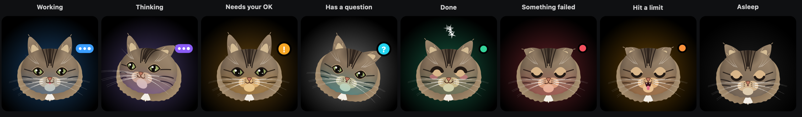

<div align="center">

# NotchMeow

**Shrimpy and Momo, two cats who live in your Mac's notch, or at the top of your screen on Windows and Linux, and keep an eye on your AI coding agents.**

Watch Claude Code, Codex, Cursor, Gemini CLI and Antigravity work, approve permission requests, drop a file, chat with Claude, all without leaving what you're doing.


</div>

---

## Meet the cats

- **Shrimpy**: a long-haired brown tabby. A full ruff, small tufted ears, green-gold eyes.
- **Momo**: a gray-and-white tuxedo. A charcoal mask with a blaze down to a white muzzle, olive-gold eyes.

Both are modelled on real cats and drawn entirely in code, like Coucou's character: eyes projected on a sphere
that follow your cursor, blinks, ear twitches, emotes, and a reaction for every agent state (thinking, working,
waiting for your approval, finished, error, rate-limited). Two motion styles, picked in Settings → Cat: **Playful** (cat body
language: ear flicks, slow blinks, a hunting crouch, a big yawn) and **Classic** (the original timings).

Shrimpy and Momo are the defaults. Fourteen more coats from the same blueprint are optional picks: Ginger (orange tabby), Midnight (black), Latte (Siamese),
Patches (calico), Blue (British shorthair), Snow (white, odd-eyed), Oreo (black-and-white tuxedo), Mocha (tortoiseshell), Silver (silver tabby),
Cloud (Ragdoll), Leo (Bengal), Button (Scottish Fold), Puff (Persian) and Noodle (Sphynx).

## How the cats react



Each state has its own look, and the site lets you try them on a live cat: [How the cats react on the site](https://aikusan.github.io/notchmeow/#react).

## Roadmap

| | What | Status |
|---|---|---|
| A | Fork and rebrand, then the Shrimpy and Momo characters on macOS, Windows and Linux | built on macOS, Windows and Linux; real-build checks pending |
| B | One cat per agent, a single chosen cat, or two together, plus kittens for Claude Code subagents and coloured small eyes | built on macOS, Windows and Linux; real-build checks pending |
| C | NotchMeow's own sounds | the pack is built and plays on macOS, Windows and Linux; per-cat voices and play rules planned |
| D | Signed releases and the website | 1.0.0 relaunch shipped; Developer ID signing is D2 (shelved) |
| H | A desktop cat: drag the big cat out of the notch and keep it on the desktop | built on macOS, Windows and Linux; real-build checks pending |
| I | A wardrobe: 16 outfits for the big cats, or Auto, which follows the calendar | built on macOS (Windows and Linux in progress); real-build checks pending |
| G1 | A file shelf in the notch: park files, drag them out later, send them to a phone | built on macOS (Windows and Linux follow); real-build checks pending |
| F1 | The agent sidekick: a recap when you come back, a plain line and a risk badge on permission requests, a nudge when an agent looks stuck, "What's Claude doing?", and a file dropped on an agent's own cat | built on macOS; Windows and Linux planned; real-build checks pending |

The full design lives in [`docs/superpowers/specs/`](docs/superpowers/specs/).

## Features

- **Live agent sessions**: Claude Code, Cursor, Codex, Gemini CLI, Antigravity, and any agent that tags its hook payload with `nm_agent` (see [`docs/AGENTS.md`](docs/AGENTS.md)).
- **Approve and answer from the notch**: Allow / Deny / Always for Claude Code permission requests, and `AskUserQuestion` choices.
- **See what Claude is editing**: each file edit shows up in the ticker with its +N −M counts, and opens as a diff.
- **Chat** with Claude, Gemini, OpenAI or a local model (Ollama, LM Studio) using your own keys *(Gemini, OpenAI and local models: macOS)*.
- **Drop a file on the notch** to ask a question about it.
- **Keyboard shortcuts** *(macOS)*: open the chat, jump to a waiting alert or your terminal, attach the front window, switch pills and mute from any app, and drive the island from the keyboard. Change or turn off each one in Settings → Shortcuts.
- **Integrations**: Stripe, n8n, GitHub, Vercel, Resend, Notion, Cal.com, Apple Music and Spotify *(macOS)*.
- **Private by design**: no telemetry, no account. Keys stay in the macOS Keychain, Windows Credential Manager or the Linux Secret Service.

## Install

**macOS 15+:** download [`NotchMeow-1.0.0-mac.dmg`](https://github.com/AIKUSAN/notchmeow/releases/download/v1.0.0/NotchMeow-1.0.0-mac.dmg) (or the [`.zip`](https://github.com/AIKUSAN/notchmeow/releases/download/v1.0.0/NotchMeow-1.0.0-mac.zip)), then drag NotchMeow to Applications. The app is not notarized by Apple, so macOS refuses it the first time: open System Settings → Privacy & Security, click **Open Anyway** next to the NotchMeow message and confirm. Control-click → Open no longer gets past it on recent macOS. When you update, the Keychain asks once for each key NotchMeow has saved: answer **Always Allow** each time, because ad hoc builds change identity.

**Windows 10/11:** coming soon, in a 1.0 update. The Windows build is still being tested on real PCs, so it is not part of 1.0.0. Until then you can [build it from source](#build-from-source).

**Linux:** download [the AppImage](https://github.com/AIKUSAN/notchmeow/releases/download/v1.0.0/NotchMeow-Linux-1.0.0-x86_64.AppImage) (make it executable with `chmod +x`, then run it) or [the `.deb`](https://github.com/AIKUSAN/notchmeow/releases/download/v1.0.0/NotchMeow-Linux-1.0.0-amd64.deb) (`sudo apt install ./<file>.deb`).

Every file is on the [1.0.0 release page](https://github.com/AIKUSAN/notchmeow/releases/tag/v1.0.0), which lists its SHA-256 checksums. No telemetry, no account.

### Build from source

**macOS** — requirements: macOS 15+, Xcode 16+, [XcodeGen](https://github.com/yonaskolb/XcodeGen).

```bash
brew install xcodegen
git clone https://github.com/AIKUSAN/notchmeow.git
cd notchmeow/NotchBuddy
xcodegen
open NotchBuddy.xcodeproj   # then ⌘R
```

**Windows** — requirements: [Rust](https://rustup.rs), Node 20+, MSVC build tools.

```powershell
git clone https://github.com/AIKUSAN/notchmeow.git
cd notchmeow/windows
npm install
npm run pack                # installer lands in windows/release/
```

**Linux** — requirements: [Rust](https://rustup.rs), Node 20+, and the WebKitGTK,
gtk-layer-shell and appindicator development packages (Debian/Ubuntu names below).

```bash
sudo apt install build-essential pkg-config \
  libwebkit2gtk-4.1-dev libgtk-layer-shell-dev libayatana-appindicator3-dev \
  librsvg2-dev libssl-dev libdbus-1-dev patchelf \
  gstreamer1.0-plugins-base gstreamer1.0-plugins-good
git clone https://github.com/AIKUSAN/notchmeow.git
cd notchmeow/windows
npm install
npm run pack                # AppImage, .deb and .rpm land in windows/release/
```

## Setup

Click the NotchMeow icon in the menu bar (macOS) or in the system tray (Windows, Linux) → **Settings…**

| What | Why | Where the key goes |
|---|---|---|
| **Claude Code hooks** | live sessions and approvals | **Install hooks** — NotchMeow backs up `~/.claude/settings.json`, merges its hooks and shows you the diff before writing anything |
| **Claude plan** *(macOS, GitHub build)* | Plan usage gauge in the notch header | **Install relay** in Settings → Agents → Plan usage, then enable "Show in the notch" |
| **Gemini CLI hooks** *(macOS, Windows, Linux)* | Gemini CLI sessions in the island | **Install hooks** in Settings → Gemini CLI — backs up `~/.gemini/settings.json` |
| **Antigravity (agy) hooks** *(macOS, Windows, Linux)* | agy sessions in the island | **Install hooks** in Settings → Antigravity — backs up `~/.gemini/config/hooks.json` |
| **Anthropic API key** | chat and questions about files | Settings → Anthropic API · Keychain / Windows Credential Manager / Secret Service |
| **Google AI API key** *(macOS)* | chat with Google AI (Gemini) | Settings → AI → Other cloud providers · Keychain |
| **OpenAI API key** *(macOS)* | chat with OpenAI | Settings → AI → Other cloud providers · Keychain |
| **Local model servers** *(macOS)* | chat with Ollama, LM Studio, llama.cpp or Jan | found automatically on this Mac; a server on your network: Settings → AI → Local models → **Add server…** |
| **Apple Intelligence** *(macOS 26+)* | chat with Apple's on-device model | turn on Apple Intelligence in System Settings |
| **Active pills** *(macOS)* | choose which tools and agents appear in the island | Settings → Active pills |
| Stripe, n8n, GitHub, Vercel, Resend, Notion, Cal.com | the service pills | Keychain / Windows Credential Manager / Secret Service, all optional |

If NotchMeow isn't running, the hook exits immediately: **Claude Code is never blocked.**

## How it works

**macOS**

- **Island**: a borderless `NSPanel` hugging the notch, driven by a small state machine (`hidden → petit → home`).
- **Character**: drawn in SwiftUI `Canvas` + `TimelineView` at 60 fps — a cat head with eyes projected on a sphere, spring animations. No Rive, no Lottie, no images.
- **Claude Code**: a tiny `nm-hook` script receives hook events and forwards them over a Unix socket to the app. For approvals it waits for your click, then answers the hook.
- **Integrations**: lightweight pollers, paused when nothing is watching.
- **Declared pills**: `PillCatalog.swift` is the single source of truth — every pill (coding tools, agents, AI providers, services) is declared there with its ID, color and category.
- **Sounds**: NotchMeow's own short WAVs, one for each moment (credits in [`docs/SOUND-CREDITS.md`](docs/SOUND-CREDITS.md)), played through preloaded `AVAudioPlayer`s.

The macOS app is native Swift 6 / SwiftUI / AppKit with **zero third-party dependencies**.

**Windows**

- A [Tauri 2](https://tauri.app) app (Rust + TypeScript): the island is a transparent, always-on-top window that never steals focus, the cat is drawn in Canvas 2D with the same shapes, timings and sounds as on the Mac.
- Claude Code hooks go through a tiny `notchmeow-hook.exe` and a named pipe; keys live in Windows Credential Manager.
- Details and differences in [`windows/README.md`](windows/README.md).

**Linux**

- The same Tauri app as Windows. On Wayland the island is a gtk-layer-shell
  overlay anchored to the top edge, and click-through is its input region.
- Claude Code hooks go through the same `notchmeow-hook`, over a Unix socket in
  `$XDG_RUNTIME_DIR`; keys live in the Secret Service.

## Credits

Built by [Lorenz Tazan](https://github.com/AIKUSAN) with Claude Code, on top of [Coucou](https://github.com/louis-cfm/coucou)
by [Louis Raillé](https://louisraille.fr). NotchMeow is an independent fork, not affiliated with or endorsed by Coucou or its author.

## License

- **Code**: MIT, see [LICENSE](LICENSE). It keeps the original Coucou copyright notice.
- **The NotchMeow name, the Shrimpy and Momo characters, icons, sounds and media**: © Lorenz Tazan, all rights reserved, see [LICENSE-ASSETS.md](LICENSE-ASSETS.md).
