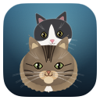

<div align="center">



# NotchMeow for Windows

**No notch on a PC, so the cat lives at the top of your screen instead.**

Approve Claude Code permissions, watch your session work, drop a file, chat with Claude, OpenAI or a model on your own computer, keep an eye on your services — without leaving what you're doing.


</div>


---

## Install

The downloadable installer is **temporarily unavailable**. Microsoft Defender
wrongly flags the unsigned installer as malware (`Trojan:Win32/Wacatac.H!ml`, a
machine-learning false positive). A report is under review at Microsoft, and the
installer will be published again once it is cleared and code-signed.

Until then, [build it yourself](#build-it-yourself): it takes a few minutes and
installs for the current user only — no admin prompt.

## Using it


| What you do | What happens |
|---|---|
| Move the mouse to the very top-centre of the screen | The cat peeks out |
| Click the small island | It opens |
| Click the cat | It gets annoyed. Three times in a row and it goes dizzy |
| Rest the pointer on the cat for two seconds | Hearts |
| Leave the cat alone for ten minutes, with no agent running | It falls asleep. A hook event, a hover or a click wakes it, with a burst of zoomies if it is in Playful. It never sleeps through an approval or a question |
| Drag a file onto the island | The cat opens its mouth, catches the file, chews it, then offers to answer questions about it. A file the app refuses (an app, an archive, a disk image, a video, over 25 MB) is caught too, then coughed back up as a hairball before the note says why |
| Drag the big cat out of the notch and drop it on the desktop | It lives there, above your windows: on Windows it watches the pointer wherever it is, on Linux it looks ahead unless the pointer is over it; it wears its badge, collar and kittens, and sleeps and wakes like the notch's cat. Click it to open the island, double-click to send it home, right-click for Open the notch, Send home and Size |
| Right-click a big cat in the island | A **Wardrobe** menu: Auto, None and 16 outfits, with a tick on the one you have. The same menu is in the desktop cat's right-click menu |

| Drag files onto the right half of the island | While files are over it the island opens into two halves: **Ask** on the left, the catch you know, and **Shelf** on the right, a tray. Release over Shelf and the files are kept there, up to 30, as links to the originals. The cat does not catch them and the desktop cat does not fly in |
| `Esc` | Closes the island |
| Tray icon | Open, Shelf, Projects, Cat on the desktop (Bring the cat home while it is out), Settings…, Pause, Quit |

Everything else happens on its own: a Claude Code permission request opens the
island with **Deny / Allow**, a finished session shows what it did, and
your integrations sit in the coloured pills next to the cat.

## Your cat

**Settings… → Cat** (Look and Personality) chooses which of the 16 cats lives at the top of your screen, how it moves (Playful or Classic), its personality (six sliders and six presets, and "Custom" once you move one), and whether it wears a **collar** in the colour of the agent it is watching: Band and tag, Band, Neckerchief, or Off, which is the default. Each cat keeps its own motion, personality and collar, **Apply to every cat** copies one cat's to all 16, and **Fur lines** draws strands on a big cat. The previews in that section move only while the window is open and has focus.

The cat reacts to what your agents do: it searches while one runs a search tool (web search, web fetch, grep, glob), and the small cats in the pills and in the compact island wear their agent's collar. Gemini CLI is blue and Antigravity pink, as on the Mac.

**Display** (Settings… → Cat → Agents' cats, at the top) chooses how the cats are shown, with a small live preview of the compact island in the chosen mode:

- **One cat** (the default): your **Main cat** everywhere, as it has always been.
- **A cat for each agent**: Claude Code is Shrimpy, and any other agent gets a random coat, different from the others and from your Main cat, the first time it appears, and keeps it. "Cats for your agents" lists them, with a picker, a dice for a new random cat and **Reset to defaults**. The agents' collars follow their cats.
- **Two cats**: a pair, Shrimpy and Momo until you pick, side by side: cat 1 shows the focused agent and cat 2 the busiest other agent (one waiting for you first, then an error, then one working). Click cat 2 to focus its agent. The pair arrives together in the launch greeting, and sleeps together.

A Claude Code **subagent** is a small kitten of its parent's cat. It shows its own state (working, searching, waiting for an approval) and leaves with a happy blink when it stops. The kittens sit under the big cat in the overview (up to three and a "+N"), tucked beside it in the compact island (up to two), as a "×N" count by the pair, and at the trailing end of an agent's pill. A subagent that never reports its end is removed when its agent stops or when the cat falls asleep after ten quiet minutes (a cat that is working sweeps nothing, so a subagent in a long, silent step keeps its kitten). Gemini CLI and Antigravity send no subagent events, and Codex has no hooks on Windows and Linux yet, so they have no kittens. Below a head of Ø28 every cat now has small coloured eyes (an iris in its coat's colours, a slit pupil and a catchlight) in place of the flat ink pills; the three black coats (Midnight, Oreo, Mocha) and their kittens glow instead, with one flat fill of the lighter iris colour and no rim.

**The cat on the desktop.** The big cat can leave the notch and live on the desktop as a companion: drag it out and drop it on empty desktop, or use **Settings… → Cat → Look → Cat on the desktop**, or the tray item. It is the same cat the notch would show (the Main cat, the focused agent's cat in A cat for each agent, or cat 1 in Two cats), so the big cat's spot in the notch is empty meanwhile; cat 2 and the pills stay. It floats above windows with its state badge, its collar in the working agent's colour and up to three of its agent's kittens (then "+N"; on the right half of the screen they stand on its left), and clicks pass through everywhere but its body. A click opens the island and a double-click sends it home; right-click has **Open the notch**, **Send home** and **Size** (Small Ø48, Medium Ø64 by default, Large Ø96). When an approval or a question is waiting it gives the surprised emote and flies into its notch spot, and flies back out when you have answered. It remembers whether it is out, its size and its spot (a spot per arrangement of screens, so a laptop alone and a laptop with a monitor each keep their own), and a cat that was out flies back out after the launch greeting. It draws 60 frames a second only while it moves, is dragged, shows an emote, gets or loses a kitten, or dances; 20 while an agent works or the pointer is near (on Linux only while the pointer is over the cat); 5 while it is idle, a still frame every two seconds asleep, and nothing while it is hidden by a fullscreen app or the screen is locked. While the cat is out, even with the island hidden, a few light checks run (on Windows a cursor read about ten times a second and a click-through check every 16 to 100 ms; on both systems a look at the screens and for a fullscreen app twice a second): the one exception to 0 % CPU while the island is hidden, and they stop when the cat is home, asleep (the hover check for waking it excepted), locked, or the display is off.

**The wardrobe.** **Settings… → Cat → Outfits** dresses the big cats: 16 outfits drawn in code (five seasonal, five everyday, four cat extras and two that belong to Shrimpy and Momo), plus **None** and **Auto**. One outfit at a time, worn by every big cat at every size: the island's main cat (compact and open, the compact notch's Ø20 cat too), both cats of Two cats mode, each agent's big cat and the desktop cat. The small cats (the pills, the mini row, the grid) and the subagent kittens stay bare, whatever their size. Auto follows the local date on the northern calendar: Dec 31 to Jan 2 a party hat, Dec 1 to 26 a Santa hat, Oct 1 to Nov 1 a witch hat, Good Friday to Easter Monday bunny ears, Jun 21 to Aug 31 sunglasses, anything else nothing; it looks again at the next local midnight with one timer that exists only while the choice is Auto (nothing polls). Point at a tile to see it on the live preview; the coat picker beside the preview shows an outfit on any of the 16 coats and stores nothing. Settings stores one value, `outfit`, in the `cat` block of `settings.json`. There is no global shortcut for it here (the Mac has ⌃⌥G): Windows and Linux have no global shortcuts, so the Settings card and the two right-click menus do it.

## The shelf

Files can wait in the notch. Drag them over the island: it opens into two halves, **Ask** (left: the cat catches one file, as ever) and **Shelf** (right: a tray). Release over Shelf and every file is kept there, up to 30, newest first. The shelf holds links to the originals and copies nothing, and it is remembered across restarts (`shelf.json` in `%LOCALAPPDATA%\NotchMeow\` or `~/.local/share/notchmeow/`; a damaged one, including a number beyond the double range, is kept as `shelf.json.bad-<ms>` before a new one is written). It opens from a Shelf drop, from the tray's **Shelf** item, or from the small count at the right end of the compact island, which shows only while the island is already compact and never wakes a hidden one.

Each tile has **Ask about it** (the file goes to the chat like a drop on Ask, as a new chat), **Send** (Windows: the system's Share window; Linux has none), **Show in folder** (with the file selected) and **Remove** (an original is never touched). A click ticks a tile, and several ticked tiles are sent together (the Send button then reads "Send N files"); Ask is off while several are ticked, and for a folder. A missing tile hides Ask, Send and Show in folder and leaves only Remove. Press a tile and move it to drag the file out of the island into a folder, a mail window or a chat. A file that moved or was deleted shows as Missing, found when the shelf opens, when a drop or Remove returns the list, when an item is resolved, and never in the background. A full shelf refuses extra files with a short note instead of dropping old ones, and a drop on Shelf never waits for the desktop cat. There is no shortcut for the shelf here (the Mac has one). The owner's real-machine checks are still owed and none is claimed as passed: a drag that leaves the window, the Windows Share window opening from the never-focused island, the Explorer `/select` call, and the Linux compositor's behaviour; the compile of the Windows-only Rust is owed to CI.

## Projects

The island shows which project each Claude Code session belongs to, what it is doing, and what waits for an answer (sub-project P, the Mac's Projects view). A project is named by its folder; the home folder is its own project, **Home**.

- **Claude only** (no other agent active): the Claude Code pill is replaced by one pill per project (its name, a state dot and its chat). A project that waits comes first. The big card shows the pinned project, else the last one clicked, else the newest: its sessions and its waiting count. Two folders with the same name show the parent's name too.
- **With other agents**: the Claude Code pill keeps its place; its title row keeps a capsule with a grey count of the projects and, when above 0, an amber count of the waiting ones, then the chevron (a label drops when the row is full, as on the Mac). The chevron opens the section under the two panels, one row per project. The chevron's open flag is kept in memory only: the section is hidden while another pill has the focus and comes back when Claude Code is focused again.
- **Two cats mode**: the overview as before, with no project cards, chevron or section.
- **The screen**: the folder tab in the island's top bar opens it, with one section per project (its name and waiting count) and its sessions as rows. A row, or the big card through its newest session, jumps to the session: a session that waits and owns the notch's approval card opens that card; a session of the Claude desktop app opens the Claude app (nothing on Linux, which has no such app); every other session, a Windows Terminal one included, opens VS Code at its folder. Sub-agents sit indented under their session. With no project it says so.
- **The peek**: resting the pointer on a project pill for 400 ms opens a card in the left card's place, with the project's sessions and sub-agents, four lines at most on Windows and Linux (the card is 108 px); the rest is "+N more". The big cat fades while it shows.
- **Pin**: right-click a project pill for **Pin** or **Unpin** (`core/pinmenu.ts`). The island is held open while the menu is up, as for the Wardrobe menu.
- **The waiting count**: an amber count of the sessions that wait (an approval or a question) at the shelf badge's place, at the right end of the compact island's wing. The waiting count comes first; the shelf badge takes the place back when nothing waits. A waiting project only adds to the count: it never opens or holds the island, never plays a sound and never calls the desktop cat.
- **Project cats**: each project wears a cat picked from its name, and it can be changed under Settings → Cat → Agents' cats → **Project cats**, where the live folder names are listed (the island sends them to the Settings window as the `projects-live` event, asked for by `projects-live-ask`). The stored value is `projectCats` in the `cat` block of `settings.json`, at most 256 projects.
- **Memory only**: a session's full folder path, its prompt, tool input and output, notification text and command are never shown, logged or stored, and the registry is gone when the app quits. Only folder names, worktree names, roles, state words, host words and step words are shown.
- **No global shortcut.** The Projects view opens from the tray's **Projects** item (its count is in the item's name) and the folder tab.

## Between your machines

The shelf can send a file to your other Macs and PCs that run NotchMeow on the same network. **Settings → Devices → Visible on this network** is **off** until you turn it on: until then nothing listens, nothing is announced, and Windows asks no firewall question. Turn it on, and the machines you can see are listed; **Pair** one, check that both screens show the same six digits, and click **They match** on each. After that, tick files on the shelf, press the small laptop button and pick a machine: the other machine shows a card with the file's name and size, **only its Accept button accepts** (the island opens for it even if it was hidden, and the desktop cat flies in), and a card nobody answers is declined after 2 minutes. A received file is saved in the `NotchMeow` folder inside your Downloads folder (on Windows the Downloads known folder, which may be redirected, so `Downloads\NotchMeow\`; on Linux the folder that `user-dirs.dirs` names as `XDG_DOWNLOAD_DIR`, else `~/Downloads`, so `~/Downloads/NotchMeow/` by default), never opened, never overwritten (a taken name gets a number), at most 4 GiB, one transfer at a time. On Windows it is marked as downloaded from the Internet (the mark of the web), so Explorer and SmartScreen treat it like a file from a browser; Linux has no such mark. The keys live in the Windows Credential Manager or the Linux Secret Service, never in a file. **Windows:** the first time Visible is on, Windows Defender Firewall asks whether to allow NotchMeow: allow it on private networks, or the other machines will not see this one. **Linux:** the link needs a running Secret Service (GNOME Keyring or KWallet); without one it says so and stays off, and keeps nothing in a file instead. Your firewall must allow UDP 5353 (mDNS) and NotchMeow's incoming connections on the local network. The link is IPv4 only.

## Claude Code


Open **Settings… → Agents → Claude Code hooks → Install hooks…**. You get the exact diff of what
will change in `%USERPROFILE%\.claude\settings.json`, the path of the dated backup
that will be taken, and nothing is written until you click. Your own hooks are
never touched, and uninstalling removes only NotchMeow's entries.

The relay is a tiny executable, `notchmeow-hook.exe`, copied to
`%LOCALAPPDATA%\NotchMeow\bin\` at launch. It is given 300 ms to reach NotchMeow and
exits cleanly if the app is closed, slow or crashed — **a Claude Code session is
never blocked or slowed down by NotchMeow.** If nobody answers a permission request
in time, NotchMeow stays quiet and Claude Code asks in the terminal as usual.

It works from any terminal — Windows Terminal, PowerShell, VS Code, Git Bash.

## Gemini CLI and Antigravity

NotchMeow also hooks into **Gemini CLI** (`gemini`) and **Antigravity** (`agy`), the way the Mac app does. A session of either gets a pill of its own in the island, with its tool calls in the ticker, like a Claude Code session. They get no approval card: that stays Claude Code's.

- **Settings… → Agents → Gemini CLI hooks → Install hooks…** writes `%USERPROFILE%\.gemini\settings.json` (`~/.gemini/settings.json` on Linux): six events, timeouts in milliseconds.
- **Settings… → Agents → Antigravity hooks → Install hooks…** writes `%USERPROFILE%\.gemini\config\hooks.json` (`~/.gemini/config/hooks.json` on Linux): five events, timeouts in seconds, all under a `"notchmeow"` key. Uninstalling removes only that key.

Both follow Claude Code's rules: you see the exact diff first, a dated backup is taken (`settings.json.bak-<time>`, `hooks.json.bak-<time>`), your own hooks are never touched, nothing is written until you click, and a file NotchMeow can't safely edit (invalid JSON, a `hooks` entry of an unexpected type) is refused with the reason. The events go through the same `notchmeow-hook` relay: it translates Gemini's `BeforeTool`, `AfterTool`, `BeforeAgent` and `AfterAgent` to `PreToolUse`, `PostToolUse`, `UserPromptSubmit` and `Stop`, maps Antigravity's `toolCall` and `conversationId` to the shapes the island reads, and answers `{}`, the "no decision" both agents expect (Antigravity's `PreToolUse` gets `{"decision":"ask"}` instead, so its own permission prompt stays). If NotchMeow is closed it exits at once, so neither agent is ever blocked.

## AI: cloud keys and local models

**Settings… → AI and chat** has three boxes, one on each of its Your AI, Keys and Local models tabs:

- **Which model answers** — *Chat* and *File questions* each use **Auto** or a
  model you pick. Auto uses your preferred cloud when it has a key (Claude, then
  OpenAI, then Google), and a model on this computer otherwise. When the cloud
  is busy or unreachable, Auto asks the local model once instead and says so
  under the reply. A rejected key, a billing limit or a refusal is never handed
  to another model.
- **Cloud providers** — Anthropic, Google and OpenAI keys. A pasted key is
  checked straight away (✓ / ✗).
- **Local models** — NotchMeow looks for Ollama (port 11434), LM Studio (1234),
  llama.cpp (8080) and Jan (1337) on this computer the first time the island opens
  and when the model picker or this box opens, never on a timer. **Add server…** takes one server on
  your network; plain `http` to another computer is flagged as unencrypted.

### Use my Claude plan

**Settings… → AI and chat → Your AI** (Choose your AI, *Use my Claude plan*) can run your own installed Claude Code for the chat (its note says "runs your installed
Claude Code"). It is found in `%USERPROFILE%\.local\bin\claude.exe` (or on `PATH`), checked when Settings opens and before a
chat's first message, never on a timer. **Sign in** opens a terminal that runs `claude auth login`; the sign-in finishes in your
browser and NotchMeow never sees it. A chat has a **level** next to its model chip: Chat only (the default), Read-only or Agent,
the last two on a folder you pick. The quick actions (Fix, Rewrite, Explain) run at a fourth level, No tools, which the picker never offers; a quick Explain chat stays at it until you pick a level. In Agent, every edit and command asks through NotchMeow's approval card in the chat, using the
hooks NotchMeow installs for Claude Code (Settings → Agents → Claude Code hooks); without them every step is refused. On Windows, Claude Code
needs **Git for Windows**, and has no command sandbox, so every command asks. Only `claude.exe` is run, not a `claude.cmd` shim.

Every reply is labelled `cloud`, `local` or `network`, and web-search sources
from Claude and OpenAI are clickable. OpenAI requests always send `store: false`.

Keys live in the **Windows Credential Manager**, never on disk and never in the
interface — the island can only ask whether a key exists. Same for every
integration key. Every model request
leaves from the Rust side: that is also why local servers accept it, since Ollama
refuses the webview's `http://tauri.localhost` origin and NotchMeow sends none.

No telemetry. NotchMeow only talks to providers you set up, to this computer, and
to servers you typed in.

### Files

A dropped file goes with the message you send next, and the rest of that conversation uses the
**File questions** model, so the file's text never reaches a model you didn't pick for files.
Dropping another file starts a new conversation. Claude and OpenAI read PDFs
and images themselves; other models get the text of PDFs, Word, RTF, HTML and
plain-text files, cut to fit the model with a note such as "I read the first 600
lines." Images and scanned PDFs headed for a model that can't see are read with
Windows' built-in OCR. Archives, apps, disk images, videos and anything over
25 MB are refused at the drop. Text files must be UTF-8. HEIC photos aren't read
yet (Claude and OpenAI reject the format): export them as JPEG or PNG.

A path copied by dropping a file on an agent's cat is meant for the agent's prompt, not a shell: on Windows each copied path is in double quotes; paste it into the agent.

## Build it yourself

You need [Rust](https://rustup.rs), [Node 22.6+](https://nodejs.org), and the
**MSVC build tools** (Visual Studio Build Tools with "Desktop development with
C++"). WebView2 ships with Windows 10/11.

```powershell
cd windows
npm install
npm run tauri dev      # live-reloading development build
npm run pack           # builds the installer and drops it in windows/release/
```

`npm run dev` alone serves the front end in an ordinary browser, which is enough
to work on the island's looks. It also serves `dev/upload-preview.html`, which
replays the whole file-drop choreography on a loop — the one part of the UI that
otherwise needs a real drag from Explorer to see. Neither page ships in the app.

`npm run pack` leaves two files in `windows/release/`, the same names the release
workflow publishes:

```
NotchMeow-Windows-X.Y.Z-setup.exe    the versioned installer
NotchMeow-Windows-setup.exe          the same file under the rolling name
```

Installing is optional — `target/release/notchmeow.exe` runs on its own. There is no
window in the taskbar and no console: the island at the top of the screen and the
the cat in the notification area are the whole app, and Quit lives in its menu.

The sounds are the macOS app's own files; they are never duplicated in this
folder. The path is declared once, in `SOUNDS_DIR` at the top of
`vite.config.ts` — when they move to `shared/sounds/`, change that one line.

The app icon and the tray icon are drawn by the Mac's real cat renderer (`CatRenderer`), so there is one source for both apps. The files in `src-tauri/icons` are committed; regenerate them on a Mac, from the repo root:

```sh
bash scripts/gen-icons.sh      # also rewrites the macOS app icon and menu bar icon
```

### Layout

```
windows/
  src/                 island front end (TypeScript, no framework)
    cat/               the cats, their motion and the launch greeting, in Canvas 2D (`dev.ts` is the `?dev` contact sheet)
    island/            state machine, hooks, integrations
    views/             every island view
    settings/          the settings window: six pages, their tabs and the pure rules
  src-tauri/           Rust backend: window, named pipe, AI providers (src/ai/), pollers
  hook/                notchmeow-hook.exe, the Claude Code relay
  scripts/             icon generator
```

### Log

`%LOCALAPPDATA%\NotchMeow\notchmeow.log` — hook events, permission decisions, poller
problems, and AI errors with the provider's request ID. Never a prompt, a file's
contents or a key. It stays on your machine.

### Testing the AI

`cargo test --workspace` (in `windows/`, after `cargo build --release -p notchmeow-hook`)
runs the shared AI test cases in `tests/fixtures/ai/` and talks to the fake model
server in `tests/fake_local_llm.py`, so it needs Python 3. From a Mac, run the
same thing in Docker: `windows/scripts/cargo-linux.sh test --workspace`.

The Windows crates are `windows` 0.61 and, as direct dependencies, `windows-core` 0.61 (the drag source's `#[implement]` names it, and it is the version `Cargo.lock` already holds) and `windows-collections` 0.2 (the Share window's file list, planned for G1); neither adds a new build.

The drag-out spike (a Debug-only command and a dev-server tab) reports a drag that ends without a copy as `cancelled` on Linux (GTK gives no "no drop" signal), where Windows reports `none` for a drop on nothing.
`npm run check:ai` (Node 22.6 or newer) checks which model setting answers a message, and `npm run check:claude` the
Claude Code parts of the chat (hook routing, the chips, step rows) against `tests/fixtures/ai/claude-code/`. The Claude Code
engine is tested with a fake `claude` (`tests/fixtures/ai/claude-code/fake_claude.py`); no test runs the real one. A debug build
reads `NM_CLAUDE_CODE_PATH_OVERRIDE` to point the app at the fake (release builds don't contain it).

To click through the chat without keys or models, debug builds read
`NM_AI_BASE_URL_OVERRIDE`, which points Anthropic, OpenAI and Google at the fake
server. Release builds don't contain it.

    python3 tests/fake_local_llm.py port.txt --fail 429      # or --persona ollama, --fail cut…
    $env:NM_AI_BASE_URL_OVERRIDE = "http://127.0.0.1:$(Get-Content port.txt)"
    npm run tauri dev

Save any text as a key, or add `http://127.0.0.1:<port>` with Settings → AI and chat → Local models → Add server….

### Testing the shelf

The shelf (sub-project G1) follows `tests/fixtures/shelf/` (`docs/SHELF-CONTRACT.md`): `src/shelf/rules.ts` (`zoneAt`, `shelfClean`, `shelfAdd`, `readShelf`) and its Rust twin `src-tauri/src/shelf.rs`, which is also the store, replays only `shelf-cases.json` (the zone rows are checked by the TypeScript test). `npm run check:cat` runs the TypeScript (`shelf-*.test.mjs`) and `windows/scripts/cargo-linux.sh test -p notchmeow shelf::` the Rust. `?dev` has a **Shelf** panel: the shelf view in its island, fed by a shelf in memory that follows the contract, with buttons for a few files, a full shelf, a folder, a missing original, ticks and the system's abilities, and a probe for which half a pointer is in. In the dev server only, a green **drag test file** tab in the compact island drags a test file out through the native drag source (in a Debug build of the app), to try it on a real machine.

### Testing the cats

The desktop cat (sub-project H) is ported from the same contract: `src/cat/desktop.ts` (the trip `desktopStep`, the flight, the frame rate `desktopFps`, the spots on the screens and `cleanDesktopSettings`, replayed from `desktop-cases.json`), with its Rust twin `clean_desktop_settings` in `src-tauri/src/cat_settings.rs`. The island's page runs the trip (`island/desktop.ts` with `cat/desktoptrip.ts`) and a second window, `desktop.html` (`src/desktop/body.ts`, `src-tauri/src/desktop.rs`), draws the cat (`cat/desktopdraw.ts`, `desktopview.ts`, `desktopflight.ts`, `desktopgov.ts`); they talk through the `desktop_relay` command. `?dev` has a **Desktop cat** panel: the cat at the three sizes on a mock desktop with its badge, collar and kittens, the alert flight as a strip of frames, and a **Measure the desktop cat** button that times a frame at each size and prints what each frame rate costs. In the dev server, `http://127.0.0.1:1420/desktop.html` loads the window's page, and `__body.handle({ k: "show", ... })` feeds it the messages the island's page sends.

The wardrobe (sub-project I) is ported from the same contract: `src/cat/wardrobe.ts` (the 18 IDs, `cleanWardrobeSettings`, `easterOf`, `autoOutfitFor`, `resolveOutfit`, `outfitWorn`) and `src/cat/outfit.ts` (`outfitAnchors`, `outfitGeometry`, `outfitRoom`, `outfitDigest`), replayed from `wardrobe-cases.json` (all 256 outfit and coat pairs at four sizes), painted by `cat/outfitdraw.ts` at the contract's three slots from `cat/renderer.ts`; `BotEngine.outfit` is set only by the island's two big cats and the desktop cat. The `outfit` key of the `cat` block is cleaned by `cleanCatBlock` and its Rust twin `clean_wardrobe_settings`; `island/wardrobe.ts` is Auto's one-shot; `settings/wardrobe.ts` and `cat/wardrobeui.ts` are the Settings card; `core/wardrobemenu.ts` builds the Wardrobe submenu of the island cat's and the desktop cat's right-click menus. `?dev` has a **Wardrobe** panel: 16 outfits on 16 coats, the compact notch's Ø20 and Ø18 cat in their strips, the head turned each way, the neck outfits over each collar style, the desktop sizes and a Two cats pair, and Auto for any date; the bench in the Desktop cat panel also measures a frame with the witch hat on. The site's cats are not dressed (the site passes no outfit), but its bundle contains the renderer, so it is rebuilt with it.

`npm run check:cat` (Node 22.6 or newer) runs the cat's checks in plain Node: the TypeScript in
`src/cat/` against the shared fixtures in `tests/fixtures/cat/`, within 1e-9 R. The fixtures are
generated from `design/prototype/cat-core.js`, which decides if the two disagree
(`docs/CAT-CONTRACT.md`). The look is checked by eye: `npx vite`, then open
`http://127.0.0.1:1420/?dev` for every coat at every size, the 11 states, the emotes and the
greeting, next to `design/prototype/notchmeow.html`. `?dev` is only served by the dev server.
`http://127.0.0.1:1420/dev/upload-preview.html` plays the file catch (add `?refuse` for the hairball).

`?dev` also has a **Collar** panel (a style and an agent colour, worn by the coat ladder at every size from Ø12 up, the States strip and the Compact notch), a "Wake the sleeping cat" button and a "dance (music)" button on the big cat. `npm run check:cat` covers the stored settings (replayed from `settings-cases.json`, with the Rust twin in `src-tauri/src/cat_settings.rs`, which `cargo test` replays too), the collar's geometry and its painting, the search tools, the sleep clock, the dance, the dead-code and old-name guards. The island's own glue (the Settings window, the hook handlers' wiring, the `?dev` page) is checked by eye and by source pins.

The app has no music source on Windows or Linux yet: the cat's bob is built (`src/cat/dance.ts`) and `State.musicPlaying` is the switch, which nothing turns on today.

The Display settings and the kittens are ports of the same contract: `src/cat/display.ts` and `src-tauri/src/cat_settings.rs` (the `displayMode`, `pair` and `agentCats` keys of the `cat` block, cleaned together with the Cat settings and kept at every save), `agentcat.ts` (an agent's coat), `cast.ts` (which cat appears where, read through `State.cast`), `kittens.ts` with `island/subagents.ts` (the hook events that start, change and end a kitten) and `kittendraw.ts`, and `smalleye.ts`. `?dev` has a **Small eyes** panel (every coat and a kitten of it at Ø12 to Ø24, ink pills beside the coloured eyes, magnified 2 times and at true size) and a **Measure** button that times twelve small cats and a big one with each. To look at the island with kittens and the pair without a real agent, open `http://127.0.0.1:1420/?display=two` (or `perAgent`) with `npx vite` and feed it hook events from the browser console, for example `__nm.hook({ hook_event_name: "SubagentStart", cwd: "C:/work/app", session_id: "s1", agent_id: "a1", agent_type: "Explore" })`; `__nm` exists in the dev server only.

### Testing the Sidekick

The agent sidekick (sub-project F1: a recap when you come back, a plain line and a risk badge on a permission request, a nudge when an agent looks stuck, "What's Claude doing?" in the chat, and a drop on an agent's own cat) is built on one set of plain rules, `shared/sidekick-core.js`, which the Mac's Swift port and the Node tests replay too (`docs/SIDEKICK-CONTRACT.md`). **This app does not carry a second hand-made port of them**: `node scripts/gen-sidekick-ts.mjs` copies the source into `src/sidekick/core.generated.ts` (never edit that file), `src/sidekick/core.ts` gives it its types, and `npm run check:sidekick` (Node 22.6 or newer) replays every file of `tests/fixtures/sidekick/` against that copy, fails if the copy is stale, and tests everything the app adds: the ledger (`ledger.ts`, memory only, fed in `island/hooks.ts` before the one-card gate), presence (`presence.ts`; the lock, sleep and display news come from `src-tauri/src/sidekick.rs`, the idle time from `platform::idle_seconds`), the notes and their gate (`notes.ts`, `world.ts`), the stuck clock (`stuckclock.ts`, one one-shot timer), the permission line (`explain.ts`), the status answer (`statuschat.ts`), the drop on an agent's cat (`agentdrop.ts`, `views/agentdrop.ts`), the local voice (`voice.ts` and Rust's `ai/oneshot.rs`) and a leak test. Rust: `cargo test` replays `settings-cases.json` for `sidekick_settings.rs`. To look at it without a real agent, run `npx vite`, open `http://127.0.0.1:1420/` and call, in the console, `__nm.run.recap()`, `loop()`, `errors()`, `waiting()`, `quiet()`, `card("high")` (or `"medium"`, `"low"`) and, with `?display=perAgent`, `agents()` and then drag a file over the island; `__nm.skew(ms)` moves the Sidekick's clock. `__nm` exists in the dev server only.

### Testing the link

The link (sub-project G2) follows `tests/fixtures/link/` (`docs/LINK-CONTRACT.md`). **Rust does all of it**, in `src-tauri/src/link/` (no Tauri type in that folder; `src-tauri/src/link_cmd.rs` is the one Tauri file: 15 commands and the `link` event): the pure rules are ports of `reference.py` replayed by `cargo test` (`name`, `frames`, `pairing`, `flow` with `places[]`, `connections[]` and `firstFrame[]`, `cards`, `noise` on the vetted `snow` crate), `channel`/`pair_run`/`transfer` are the conversations over `Transport` (in memory in the tests, `net.rs` on TCP in the app), `conformance.rs` plays the real runs against the recorded conversations of `noise-vectors.json` byte for byte, `service.rs` is the actor that owns every decision, and `mdns.rs` is the advert and the browser on `mdns-sd`. The page (`src/link/`, `views/link.ts`, `views/shelfdevice.ts`, `island/link.ts`, `settings/devices.ts`) holds only what Rust last said (`LinkStore`) and ids, never a key, an address or a path; `npm run check:link` replays the snapshot samples shared with Rust, the island's rule for a card, the desktop cat's alert for an offer and the wiring pins, and `windows/scripts/cargo-linux.sh test -p notchmeow link::` runs the Rust. **Two new crates** were approved by the owner on 2026-10-14: `snow` (Noise, MIT/Apache-2.0) and `mdns-sd` (mDNS, MIT/Apache-2.0); `sha2`, `unicode-normalization` and `getrandom` were already in the lock. `?dev` has a **Link** panel (the real card in an island frame, fed by a stand-in service that never opens a socket) and `http://127.0.0.1:1420/settings.html?linkdev=on` (or `off`, `empty`, `problem`, `note`) draws Settings → Devices from the same stand-in. `windows/scripts/test-link-peers.sh` runs two real `link_peer` processes (the `link_peer` example, built in the container, keys in memory, a terminal for an island) on loopback in the Linux container and checks the six digits, a file's SHA-256 and a declined file; run `link_peer` next to the Mac's Debug build to pair with it by mDNS. **Owed to the owner's real machines and CI:** the Windows Firewall prompt, the Windows Credential Manager, the Linux Secret Service, mDNS across a real network, the Downloads folder, the mark of the web, and the compile of the Windows-only Rust.

### Testing the projects

`npm run check:projects` replays `tests/fixtures/projects/` (with counted groups, so a changed fixture shows) and the Mac's `tests/fixtures/mac/projects-scenarios.json` through the model, and fails on a stale `src/projects/core.generated.ts` (write it with `node scripts/gen-projects-ts.mjs`). On the dev server (`npx vite`, then `http://127.0.0.1:1420/?dev`), the Projects panel draws the shipped views in five island frames from its own model and clock. The app's own dev hooks are `window.__nm.projects.run("many")` (a scenario through the same hook path as the relay's events) and `window.__nm.projects.age(5)` (moves the clock by minutes). The Rust tests for the Project cats' clean-up and the tray item are `cargo test cat_settings` and `cargo test tray`.

## What's different from the Mac version

- No notch, so the island lives at the top centre of the screen and retracts into
  the top edge instead of hiding in a notch.
- Permission approval works from **any** terminal; the Mac build only listens to
  VS Code sessions.
- Not in this version: sending a file by email, dragging the cat onto a window to
  attach it as context, and jumping to a specific terminal window — "Open
  terminal" opens the working folder in VS Code when `code` is on your `PATH`.
- Cal.com shows the next bookings as a list rather than the Mac's calendar.
- No Apple on-device model: that one is macOS only.
- Codex has no hooks here yet, so there is no Codex pill and no Codex kittens; Claude Code's subagents are the only kittens. In Settings → Cat → Agents' cats, the list of agents is in a fixed order (Claude Code, then the others by their IDs): this app's Settings window does not see the island's pills, so it cannot sort them by their last event.
- **The Sidekick (F1) here has no Codex**, because there are no Codex hooks on Windows or Linux. The permission line and badge are for Claude Code only (Gemini CLI and Antigravity have no permission card). **A failure has no reason here**: "hit 3 errors in a row" is all the app can say, because the relay drops the error text (and `tool_response`, `transcript_path` and the assistant's words never cross the pipe at all). **Away** is a lock or a switch to another user, a sleep (Linux) or the display going off (Windows), at once; 5 minutes with no input counts too (Windows, and GNOME on Linux), but it is read only when a hook event comes, when the island opens or on an unlock, so a recap after plain idling waits for the first of those. **A file dropped on an agent's cat** copies its path (a small clipboard command of this app), brings VS Code forward on Windows by the same "Open terminal" action and opens nothing on Linux; while a file is dragged, a small chip for each running agent is shown on the drop view (an additive strip: the drop view has no cats of its own and is not moved), and the big drop area is as it was. **The nicer wording from a local model** asks only a server on this computer (`ai_oneshot`, never the chat's Auto choice), and there is no Apple on-device model. **The clipboard on Windows** double-quotes every copied path (several paths: each one double-quoted, one space between, on one line), and refuses the whole drop when a path holds a control, format, separator or default-ignorable character, a lone surrogate, `$`, a backtick, `%`, `!`, a double quote or one of the typographic double quotes, a space other than U+0020, ends in a backslash, or an entry is empty or not a string. Linux keeps the Mac's POSIX rule. **Owed, not run here**: the Windows copy and the Windows half of the lock state are owed to CI (`windows-tests.yml`) and to the owner's real build; nothing in this section was run on Windows.
- Images and scanned PDFs for a model that can't see go through Windows' own OCR
  (`Windows.Media.Ocr`) instead of the Mac's Vision framework.
- **The island gets out of your way** (the Mac's wings and outside click, U1b). On the compact island the pointer over either **wing** (the 52 px each side of the 184 px middle; the big cat on the left, the grid and the shelf badge on the right) makes the whole island swoosh into its middle: over the right wing at once, over the left (the big cat) after the pointer has rested there 0.4 s with no mouse button pressed, so a click, the drag out to the desktop and the right-click on the cat work as before. The cats, grid and badge fade, the mouse passes through to what is under the wings (a window's title bar, a tab), the island comes back 1 s after the pointer has left both wings, and a waiting card, a file on its way in, the shelf's hold or the desktop cat away from the notch cancels it. The 184 px middle stays on screen: a PC has no notch to disappear into. With Open on hover on, the pointer on a wing opens nothing. A **click outside the open island folds it** (like Escape), on the release of a click (a press that moves more than 4 px, such as a file taken out of Explorer, is not one), except when something waits for you (a permission request, a question, the shelf's drag-out or Send), it is pinned, you are typing in the chat, a native menu of the island is open, the click is on another window of NotchMeow (Settings, the desktop cat, the tray's menu), or the cat or a file is being dragged. How: the island's cursor poll, which already runs while it is showing, also reads the three mouse buttons, and only while the island is open (and, on the compact island, one "a button is held" read per cursor event for the left wing's rule); there is no mouse hook and no new timer (one one-shot timer runs only during the left wing's 0.4 s or the 1 s return). A click shorter than the poll's 16 ms tick can be missed.
- **The Open of a Claude Code session from the Claude app** (it shows under the Claude Code pill, and its host is the app) starts the Claude desktop app: the pill's arrow, the finished card's "Open Claude" button, a Sidekick nudge's button and a file dropped on the pill's cat. For the app it tries, in order, `%LOCALAPPDATA%\AnthropicClaude\claude.exe`, `%LOCALAPPDATA%\Programs\Claude\Claude.exe`, `%ProgramFiles%\Claude\Claude.exe`, the Start-menu `%APPDATA%\Microsoft\Windows\Start Menu\Programs\Claude.lnk`, then the packaged app that the Start menu lists as "Claude" (its AUMID from `Get-StartApps`); an app that is already running is brought forward. Linux has no official Claude desktop app, so the button is not shown there. **Owed, not run here**: nothing ran on Windows, so the install type is unverified; the order is a guess, tested only with fake folders on Linux.
- The wardrobe has no global shortcut here (the Mac's ⌃⌥G, off by default): Windows and Linux have no global shortcuts. Settings… → Cat → Outfits, the island cat's right-click menu and the desktop cat's right-click menu do the same. In Settings, Wardrobe is the Outfits tab of Cat (the Mac puts it inside its Cat section).

- The shelf holds paths only: promised files (Mail, Photos) and browser images do not exist here, so nothing is copied; its tiles show a file icon, not a thumbnail; it opens from a tray item, not a menu-bar one; and it has no global shortcut. Send is the Windows Share window, and Linux has Show in folder only. Dragging a tile out is the system's own drag: OLE on Windows, GTK (`text/uri-list`) on Linux.
- A number beyond the double range (`1e400`, or a 400-digit size) makes `shelf.json` unreadable: the old bytes are kept as `shelf.json.bad-<ms>` and the shelf starts empty.
- Nesting deeper than 128 anywhere in the file makes `shelf.json` unreadable the same way: the old bytes are kept as `shelf.json.bad-<ms>` and the shelf starts empty.
- On Linux a drag that ends without a copy reports `cancelled` (the GTK drag has no "no drop" signal).
- The desktop cat has no global shortcut here (the Mac has one): the tray item, the Settings switch, dragging it out and a double-click do the same. A fullscreen app hides it (found by looking at the foreground window). Windows' virtual desktops are not followed: it stays on the one it was put on.
- The desktop cat hides on a user switch too: a switch to another user counts as away and locked, so it hides then. The owner accepted this, since nobody is at the desk.
- The link keeps its keys in the Windows Credential Manager or the Linux Secret Service through the `keyring` crate, which cannot list items, so one item (`link.peers`) lists the paired machines; a store that cannot be read makes the link say why and stay off, and never makes a new key. A Debug build uses its own service name. Settings are in `link.json` (Visible and the name), written by Rust alone. A received file on Windows carries a `Zone.Identifier` stream (the Mac's quarantine attribute); if the drive cannot hold one (not NTFS) the file is refused, not saved unmarked. The advert and the listener are IPv4 only. "Devices is open" is the Devices section being visible in the single Settings page, reported by the page as a state and forced off by Rust when the Settings window hides. The Mac's Debug fake peer is the `?dev` Link panel and `link_peer` here.
- A received file on Windows is held open while it is written, with delete access and without the right to share deleting, so nobody can rename, replace or delete it meanwhile; it is marked for deletion through that handle as soon as its mark of the web is written, and the mark comes off only when the transfer is complete. From the moment the file is marked, a transfer that does not finish (declined, cancelled, failed), a clean quit, a crash and `kill -9` all end with Windows removing the file when the handle closes, and no file is ever removed by its path, except the one removal in `open()` when Windows refuses the mark for deletion, for a file made a moment before. A power loss or a blue screen still leaves the partial file (the delete-pending state is in memory only). Known limit: a crash or `kill -9` in the instant between creating the file and marking it (the mark of the web is written in between) can leave an unmarked partial file in `Downloads\NotchMeow\`. Known limit: while the file is being written no other program can open it either (an antivirus scan waits for the end), and a drive that does not support streams refuses the file. Linux removes a partial file by its path after checking the device and inode of the file it made (a window of microseconds is left between the check and the removal); on a clean quit the exit hook removes it (`link::files::remove_partials`), and `kill -9`, a crash and a power loss can still leave a partial file in `Downloads/NotchMeow` there.
- If the mDNS daemon ends on its own, the machine list is emptied and the daemon is made again after 1 s, then 5 s, 30 s and every minute for as long as this machine is visible (or Devices or the shelf is searching), announcing the machine again and searching again; a minute of life starts the table over (`link/restart.rs`, `link/mdns.rs`). Nothing is made again while Visible is off and nobody is searching. A restart that keeps failing shows an empty list and no message.
- **Settings** has the Mac's six pages (General, Agents, AI and chat, Services, Cat, Devices), with tabs only on AI and chat and on Cat; General has none, since there are no shortcuts here. There is no Codex card, no Plan usage, no main-pill picker, no AI pill switches, and no Apple or Music rows. Agents → Where you code has one switch each for Gemini CLI and Antigravity, and General → Island has "Island lives on". The window opens at 720 × 560 (415 × 420 at least) and follows the system's light or dark mode, with every text pair at 4.5:1 or better. A key field shows only whether a key is saved, never the key.

- Projects opens from the tray's item and the folder tab, with no global shortcut, and its compact count shares the shelf badge's spot (waiting first).
- **The companion chat has no Services here**. Its quick actions (Fix, Rewrite, Explain) work on the text in the chat's field, or on a PNG pasted into it; the Fix and Rewrite reply shows in the quick card with a Copy button. There is no Replace, no clipboard reading and no global shortcut, and memory and the daily recap come in 1.1.
- **Focus awareness** covers permission requests only: there is no question card here and no `--ask` hook, so the Mac's twin rule does not apply. Windows matches the Claude app, the VS Code family (`TERM_PROGRAM=vscode`, Cursor by name) and Windows Terminal (`WT_SESSION`); plain consoles and other terminals are not matched, because the relay carries no marker for them. Linux matches only under X11 (the VS Code family, kitty, WezTerm, Alacritty and Ghostty by window class) and does nothing under Wayland. The foreground read waits 300 ms at most. The process and class names are unverified on real machines; a mismatch only means the card shows as it does today. The setting is General → Island, `focusAware` in `settings.json`.

## Linux

The same app builds for Linux: everything that differs lives in
`src-tauri/src/platform/`, and the relay's transport in `hook/src/unix.rs`.

```bash
sudo apt install build-essential pkg-config \
  libwebkit2gtk-4.1-dev libgtk-layer-shell-dev libayatana-appindicator3-dev \
  librsvg2-dev libssl-dev libdbus-1-dev patchelf \
  gstreamer1.0-plugins-base gstreamer1.0-plugins-good
npm install
npm run tauri dev      # live-reloading development build
npm run pack           # AppImage, .deb and .rpm in windows/release/
```

What changes on Linux:

- **The island** is a gtk-layer-shell overlay anchored to the top edge, over any
  top panel, on compositors that support it: COSMIC, KDE Plasma, Hyprland, Sway
  and other wlroots compositors. GNOME has no layer-shell, so there the island
  is a regular window. `NOTCHMEOW_LAYER_SHELL=0` forces that mode anywhere.
- **Click-through** is the window's input region, kept equal to the island
  shape, so the compositor sends every other click to what is underneath.
- **The cat on the desktop** is its own small window. On compositors with layer-shell it is a surface on the top layer (below fullscreen windows, so it steps aside over a fullscreen app) placed with margins on the screen that holds it. On GNOME's Wayland session the system ignores a window's position: the cat lands where GNOME puts it, you can drag it from there, the flight is drawn inside its own window, its spot is saved but GNOME may not keep it, and Settings says so under the switch. On X11 its position is ours, except under XWayland (`GDK_BACKEND=x11` inside a Wayland session), where it is not: `desktop_positioned()` is false there, as on GNOME. `NOTCHMEOW_DESKTOP_POSITION=1` or `0` overrides the guess.
- **The cat's eyes** follow the pointer only while it is over the island. Under Wayland, no app gets the cursor position anywhere else (under X11 it follows across the screen, see the wings below; not under XWayland, see there).
- **The wings and the outside click** need to know where the pointer is on the whole screen. **Under X11 they work** (the island reads the pointer through Xlib about 60 times a second while it is showing, nothing while it is hidden; the cat's eyes then follow the pointer across the screen, as on Windows). An app started with `GDK_BACKEND=x11` inside a Wayland session (XWayland, `WAYLAND_DISPLAY` set) gets no pointer feed (`x11_feed` in `platform/linux.rs`: its pointer is stale over native Wayland windows), so it behaves as under Wayland. **Under Wayland, on every compositor (KDE, COSMIC, Hyprland, Sway and GNOME alike), they do not exist**: Wayland tells an app nothing about a click that lands on another app's window; on the layer-shell compositors (KDE, COSMIC, Hyprland, Sway) a layer surface also gets no pointer event outside its input region (which is what lets clicks through), and GNOME has no layer-shell at all, so the island could neither see an outside click nor see the pointer leave a wing to come back. There the island behaves as before: Escape, a click on the compact island, its own auto-close. No pointer is polled, and nothing changes. Window blur is not a way round it: the island never takes the keyboard focus except for the chat.
- **The Claude desktop app** has no Linux build from Anthropic, so such a session shows no Open button on Linux.
- **The wardrobe's menu** holds the island open only where the menu blocks until it closes (Windows and the Mac). On GTK (Linux) Tauri's menu popup returns as soon as the menu opens and gives no close event, so the hold ends at once and the island folds while the menu is up, as it did before the hold.

- **The shelf** has no Send (there is no system share). **Show in folder** asks the file
  manager to select the file (the freedesktop `FileManager1.ShowItems` call, through `gdbus`) and
  opens the folder where none answers. A drag out of a tile is a GTK drag of a `text/uri-list`;
  a drag that a compositor refuses ends as `cancelled`, and the tile stays draggable. Drag out is
  hidden only by the constant `dragout::supported()`. On Linux the half is the drag event's
  position divided by the page scale.
- **Claude Code hooks** go through `~/.local/share/notchmeow/bin/notchmeow-hook` and a
  Unix socket at `$XDG_RUNTIME_DIR/notchmeow.sock`. Both ends check that the other
  runs as the same user.
- **Keys** live in the Secret Service (GNOME Keyring, KWallet).
- **Files**: preferences in `~/.config/notchmeow/`, the log at
  `~/.local/share/notchmeow/notchmeow.log`.
- What the Windows build leaves out, this one does too: sending a file by
  email, dragging the cat onto a window, and jumping to a specific terminal
  window — "Open terminal" opens the folder in VS Code.
- **AI**: no OCR and no PDF renderer on Linux. An image headed for a model that
  can't see gets "This model can't see images. Pick one that can." A scanned PDF,
  for any model but Claude and OpenAI, gets "I can't read scanned PDFs on Linux
  yet. Try Claude or OpenAI, or paste the text." Claude and OpenAI read both
  natively.
